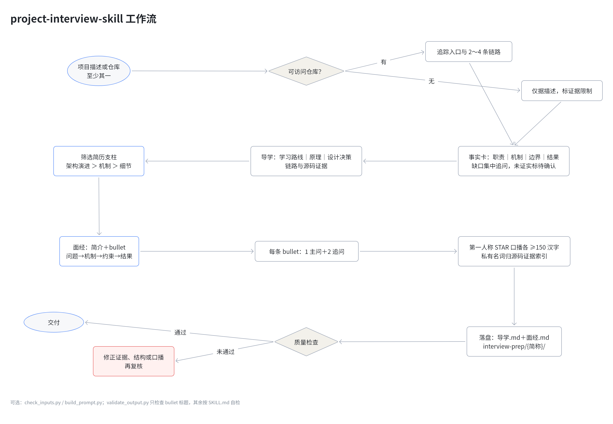

<div align="center">
  <h1>project-interview-skill</h1>
  <p><a href="https://github.com/Jaxon1216/interview-analyzer-skill/blob/main/README_EN.md">English</a></p>
  <p><em>把你的项目经历，变成可复述、可追问、可上场的面试战斗手册。</em></p>
  <p>
    <a href="LICENSE"></a>
    
    
    
    
    
    
  </p>
</div>

把真实项目变成能讲、能追问、能复习的面试材料，主文件输出到 `interview-prep/{简称}/`，核心课程输出到 `interview-prep/guide-{方向}/`。

## 核心能力

- 核心链路探索：追踪入口、关键机制、失败边界与源码证据，再提炼技术支柱
- 业务主线与证据：按服务对象、目标和障碍组织支柱，区分实现、责任与结果，保留指标口径及历史决策来源
- 简历 bullet：把仓库已有机制整理成目标简历，配套学习后选用，不主动核验提交作者
- 面试展开：从简历主张生成主问，按前序回答递进追问，答案按题型组织
- 表达护栏：约束内部名词和实现细节，转换成外部面试官听得懂的说法
- 源码课程：默认全栈，首次展开全部核心课程，关联 bullet、Q&A 与源码，直接讲明重点、必懂原理和必记结论
- 前后端样例：内置参考模板，帮助校准表达深度和面试口径

## 快速开始

```bash
npx project-interview-skill install
```

安装完成后，在目标项目根目录开启新对话，直接输入：

```text
/project-interview-skill 简称：电商；项目描述：......；技术栈：Vue3、Pinia、Vite；求职方向：前端
```

## 生成结果

从一次自然语言输入开始，Skill 会把项目拆成三条可执行的准备路径：

<p align="center">
  
</p>

<table>
  <tr>
    <td width="50%" align="center"><strong>面经：按简历支柱展开</strong></td>
    <td width="50%" align="center"><strong>导学：安排学习顺序</strong></td>
  </tr>
  <tr>
    <td></td>
    <td></td>
  </tr>
</table>

## 工作流

Skill 从项目描述或可访问的仓库出发，先整理项目事实与源码证据，再生成导学、简历支柱和面经，最后检查产物是否符合规则。未实现增强另列进阶目标；缺少个人提交证据不影响目标机制入选。



[查看可编辑的飞书画板](https://bytedance.larkoffice.com/docx/EedMdMYZwoM5JHxVHAOc37NOnPf)

## 安装方式

默认安装到用户级通用 Agent 目录：

```text
~/.agents/skills/project-interview-skill/
```

如果你明确使用某个编辑器或 Agent，建议显式指定产品：

| 目标 | 用户级安装 | 安装位置 |
|------|------------|----------|
| 通用 Agent / Codex | `npx project-interview-skill install --agents` | `~/.agents/skills/project-interview-skill/` |
| Trae | `npx project-interview-skill install --trae` | `~/.trae/skills/project-interview-skill/` |
| Cursor | `npx project-interview-skill install --cursor` | `~/.cursor/rules/project-interview-skill/` |
| VS Code | `npx project-interview-skill install --vscode` | `~/.copilot/instructions/project-interview-skill.instructions.md` |
| Claude Code | `npx project-interview-skill install --claude-code` | `~/.claude/skills/project-interview-skill/` |
| Codex | `npx project-interview-skill install --codex` | `~/.agents/skills/project-interview-skill/` |

也可以一次安装到全部支持目标：

```bash
npx project-interview-skill install --all
```

只查看会安装到哪里，不写入文件：

```bash
npx project-interview-skill install --trae --dry-run
npx project-interview-skill doctor
```

## 项目级安装

如果你只想让某个业务项目使用这个 skill，进入业务项目根目录后执行：

```bash
cd /path/to/your-project
npx project-interview-skill install --project --trae
```

支持的项目级目标：

| 目标 | 项目级安装 | 安装位置 |
|------|------------|----------|
| 通用 Agent / Codex | `npx project-interview-skill install --project --agents` | `.agents/skills/project-interview-skill/` |
| Trae | `npx project-interview-skill install --project --trae` | `.trae/rules/project-interview-skill/` |
| Cursor | `npx project-interview-skill install --project --cursor` | `.cursor/rules/project-interview-skill/` |
| VS Code | `npx project-interview-skill install --project --vscode` | `.github/instructions/project-interview-skill.instructions.md` |
| Claude Code | `npx project-interview-skill install --project --claude-code` | `.claude/skills/project-interview-skill/` |
| Codex | `npx project-interview-skill install --project --codex` | `.agents/skills/project-interview-skill/` |

安装完成后，重启对应 IDE / Agent，开启新对话。

## 使用方式

随后在该业务项目根目录的 `interview-prep/{简称}/` 下生成：

| 文件 | 用途 |
|------|------|
| `导学.md` | 项目地图、核心课程路线、前置依赖、简历与面试导航、选读及验证建议 |
| `面经.md` | 1～2 句简历摘要、以 `- **支柱名：**` 开头的 bullet、按简历支柱展开的面试题（主问/追问口播） |

默认还会完整生成 `interview-prep/guide-fullstack/01-主题.md` 等核心课程；明确前端或后端时使用 `guide-frontend` / `guide-backend`。多项目输出根目录中，课程放到各自的 `{简称}/guide-{方向}/`。用户明确只要大纲或指定章节时遵从本次范围。

默认读者懂语言和框架基础、能写 CRUD。每课直接讲清重点、数据流、关键源码、机制边界、需要懂什么与需要记住什么，按“看懂链路 → 理解机制 → 设计与表达”分层。默认不设置预测、动手验证或理解题；用户明确要求时再补。基础按需补齐，选读按需展开。

Bullet 默认对照[酥神简历模板](skill/project-interview-skill/references/excellent-resumes/susu-bullet-template.md)：以具体机制命名，直接写动作与效果，相关约束融入步骤，复杂内容分层；不机械填四槽、不加待测尾注或未来计划。每条目标 bullet 都关联主问、核心课程和源码；追问由简历或前序回答触发。用户要求“仅整理实际贡献”时才限制个人参与范围，未实现能力与未测量收益不写成已完成结果。

交付后可运行结构校验（路径替换为实际安装目录）：

```bash
python3 ~/.agents/skills/project-interview-skill/scripts/validate_output.py interview-prep/电商/面经.md --guide interview-prep/电商/导学.md
```

校验覆盖 bullet 格式、B/Q/C 关联、核心课程关键章节及本地文件链接；技术准确性与问题相关性仍需内容审读。

也可以不写 slash 命令，直接描述“请基于这个项目生成导学和面经”。

## 源码安装兼容入口

`install.sh` 仍保留给 clone 仓库的用户使用，但它只是 Node CLI 的兼容包装器：

```bash
git clone https://github.com/Jaxon1216/interview-analyzer-skill.git
cd interview-analyzer-skill
./install.sh --trae
./install.sh --project --cursor
```

npm 包不会打包 `install.sh`；对普通用户优先推荐 `npx project-interview-skill ...`。

## 可直接复制的 Skill Bundle

仓库外层是 npm CLI 和开发工程；真正可独立迁移的 Skill 位于：

```text
skill/project-interview-skill/
├── SKILL.md
├── references/
└── scripts/
```

复制这个目录即可迁移 Skill，不需要复制 `bin/`、`tests/` 或 `package.json`。npm CLI 安装时也只从这个目录生成目标 Skill。

## 仓库结构

```text
interview-analyzer-skill/
|-- skill/
|   `-- project-interview-skill/
|       |-- SKILL.md
|       |-- references/
|       |   |-- rules/
|       |   |-- templates/
|       |   |-- examples/
|       |   `-- excellent-resumes/
|       `-- scripts/
|-- bin/
|   `-- project-interview-skill.js
|-- install.sh
|-- package.json
|-- .npmrc
|-- README.md
|-- README_EN.md
|-- docs/
|   |-- images/
|   `-- promo.md
|-- LICENSE
`-- tests/
```

## 常见问题

### 为什么默认安装到 `.agents/skills`？

这是最稳的用户级默认值，不依赖猜测用户正在使用哪个产品。如果你明确使用 Trae、Cursor、VS Code 或 Claude Code，使用对应参数即可。

### `install` 会自动探测产品吗？

不会。当前设计刻意收敛：默认只装到通用 `.agents/skills`，分产品安装必须显式指定 `--trae`、`--cursor`、`--vscode`、`--claude-code` 或 `--codex`。`doctor` 只展示路径，不安装。

### 更新后会自动生效吗？

不会。已安装目录是拷贝产物。使用 `@latest` 获取最新版，再安装到原来的目标位置：

```bash
npx project-interview-skill@latest install --agents
```

上面适用于通用 Agent / Codex。Trae、Cursor、Claude Code 等用户将 `--agents` 换成原安装参数；项目级安装需在目标项目根目录添加 `--project`。更新会替换对应 skill 安装目录，生成的 `interview-prep/` 材料需要重新调用 skill 才会更新。

更新后重启对应 Agent / 编辑器并开启新对话。可查看安装的版本：

```bash
rg 'version:' ~/.agents/skills/project-interview-skill/SKILL.md
```

需要固定版本时，将 `@latest` 换成明确版本，例如 `@1.4.1`。

## 测试与验证

运行 `npm test` 检查脚本与交付结构，运行 `npm run pack:check` 检查发布内容。业务选材、指标归因和历史决策的行为测试另行审读，不能由结构校验代替。

测试用例、复跑方式和 DeerFlow 实仓验证记录见 [tests/README.md](tests/README.md)。

## 反馈与支持

- 需求 / 建议 / 商用 / 二开：**jiangxu05@outlook.com**
- 欢迎 **Star**、**Fork** 按场景定制、**Issue / PR** 一起改进

## License

本项目采用 **MIT License**，完整条款见 **[LICENSE](LICENSE)**（英文正文 + 中文参考译文；若理解有出入，以英文为准）。
