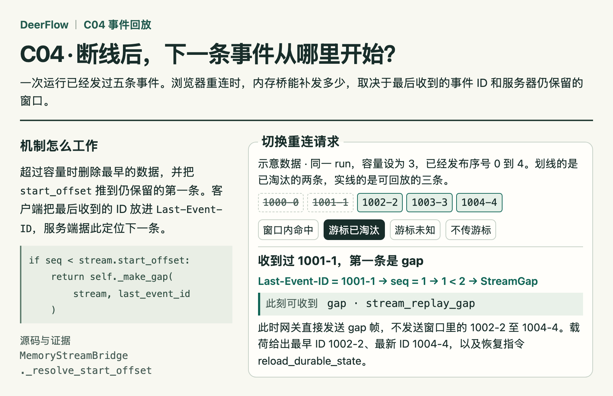
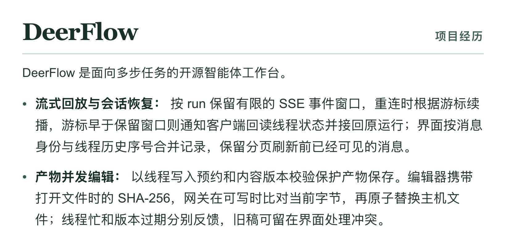

# Project Interview Skill · 项目源码导学与面试准备

**简体中文** · [English](README_EN.md) · [npm](https://www.npmjs.com/package/project-interview-skill) · [预览 HTML 课程和简历要点](#deerflow-example)

把项目仓库交给 Codex 等 AI 编程助手，生成项目导学、源码课程、简历要点和面试问答。顺着一条简历要点，你能看到面试官可能怎么追问，再沿课程链接找到支撑回答的代码。

## 安装：跨项目使用，还是只给当前项目用？

安装器需要 **Node.js 18 或更高版本**。选下面一种即可：

**跨项目使用（默认，适用于 Codex 和读取 `.agents/skills/` 的助手）**。在任意目录运行：

```bash
npx project-interview-skill@latest install
```

安装到 `~/.agents/skills/project-interview-skill/`。这里的 `~` 是你的用户主目录；使用 Codex 不需要另加参数。

**仅当前项目使用**。在你要分析的**项目根目录**运行：

```bash
npx project-interview-skill@latest install --project
```

安装到该项目的 `.agents/skills/project-interview-skill/`。如果想和队友共用，可以把这个目录提交到项目仓库。

<details>
<summary>Claude Code、Cursor、Trae、VS Code Copilot 装到哪里？</summary>

在安装命令末尾加对应参数，例如 `npx project-interview-skill@latest install --claude-code`。下表列出**父目录**；安装器会在其下创建 `project-interview-skill/`。

| 助手 | 参数 | 用户级父目录 | 加 `--project` 后的父目录 |
| --- | --- | --- | --- |
| Claude Code | `--claude-code` | `~/.claude/skills/` | `.claude/skills/` |
| Cursor | `--cursor` | `~/.cursor/rules/` | `.cursor/rules/` |
| Trae | `--trae` | `~/.trae/skills/` | `.trae/rules/` |
| VS Code Copilot | `--vscode` | `~/.copilot/instructions/` | `.github/instructions/` |

VS Code Copilot 还会在同一父目录生成 `project-interview-skill.instructions.md`。想先看实际路径，可在安装命令后加 `--dry-run`。若要使用 GitHub 当前源码，克隆本仓库后在仓库根目录运行 [`./install.sh --agents`](install.sh)。

</details>

## 如何更新到最新版？

**重跑最初的安装命令**，保留 `@latest`、客户端参数和安装范围。默认安装的用户，在任意目录运行：

```bash
npx project-interview-skill@latest install
```

如果当初只为某个项目的 Claude Code 安装，则回到那个项目根目录运行 `npx project-interview-skill@latest install --project --claude-code`。安装器会替换目标 skill 目录；已经生成的 `interview-prep/` 不会随之改写。安装或更新后，重启助手并开启新对话。

## 第一次使用：从导学开始

用助手打开目标仓库，把这句话发给它：

```text
使用 project-interview-skill 分析当前仓库。我准备面试后端研发岗位，
请把项目导学、核心源码课程和面经写到 interview-prep/，给适合演示的难点配上 HTML 专题。
```

只有项目描述时也可以直接粘贴材料；缺少源码的部分会标明。生成后，从 `interview-prep/<项目简称>/导学.md` 开始：

| 想做什么 | 打开哪里 |
| --- | --- |
| 先弄清项目怎么跑 | **导学.md**：看模块、调用链和推荐学习顺序。 |
| 读懂一个机制 | **核心课程 Markdown**：沿场景读源码，看正常路径、异常分支和设计取舍。 |
| 比较条件变化后的结果 | **HTML 专题**：从导学或对应课程点进去，离线切换条件。主会话通常选 1～3 个难点；支持子 agent 时按专题分工，没有合适题材时保留 Markdown 即可。 |
| 准备面试 | **面经.md**：从简历要点练主问、追问和第一人称回答。若只想写本人做过的工作，说明参与范围并要求“仅整理实际贡献”。 |

<a name="deerflow-example"></a>

## DeerFlow 样课与简历要点

分析 DeerFlow 仓库后，skill 写出了 8 节源码课、2 个 HTML 专题和 6 条简历要点。下面节选一页 HTML 课和两条简历原文。

### HTML 源码课

这节课讲浏览器断线后怎么接上原来的任务。切换“窗口内命中”和“游标已淘汰”，可以看到服务器还能补发哪些事件，什么时候需要重新读取线程状态。下图节选了课程正文和交互演示。



[下载离线 HTML 课程包](https://raw.githubusercontent.com/Jaxon1216/interview-analyzer-skill/main/docs/examples/deerflow/deerflow-c04.zip) · [阅读配套导学](docs/examples/deerflow/导学.md)。解压课程包后，用浏览器打开其中的 HTML 文件即可切换游标。

### 简历要点

同一个断线重连机制，在面经里写成了“流式回放与会话恢复”。下面是这份项目简历的两条原文。



[复制全部 6 条简历要点](docs/examples/deerflow/resume-bullets.md)

[测试与验证](tests/README.md) · [反馈问题](https://github.com/Jaxon1216/interview-analyzer-skill/issues) · [联系维护者](mailto:jiangxu05@outlook.com) · [MIT 许可证](LICENSE)
