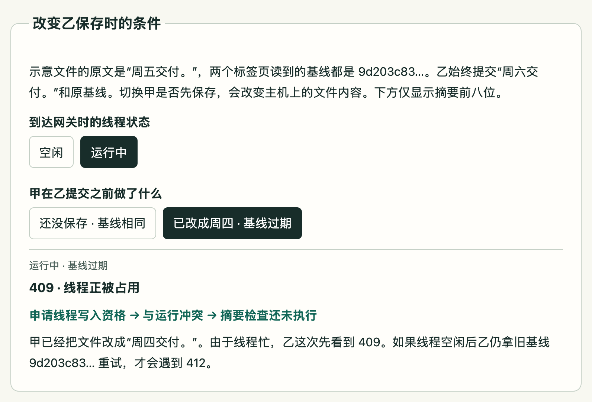

# Project Interview Skill · Source code walkthroughs and interview prep

[简体中文](README.md) · **English** · [npm](https://www.npmjs.com/package/project-interview-skill) · [DeerFlow example](#deerflow-example)

Give your coding agent a project repository and a target role. It builds a linked study guide with source code lessons, resume bullets, and interview questions and answers, so you can trace each claim back to the code that supports it.

## Installation

Requires **Node.js 18+**. To make the skill available across projects in Codex or another agent that reads `.agents/skills/`, run this from any directory. The skill goes in `~/.agents/skills/project-interview-skill/`.

```bash
npx project-interview-skill@latest install
```

To install only for the current project, run this from its root. The skill goes in `.agents/skills/project-interview-skill/`.

```bash
npx project-interview-skill@latest install --project
```

<details>
<summary>Install for Claude Code, Cursor, Trae, or VS Code Copilot</summary>

Append the flag for your editor to either command above. Each parent directory below receives a `project-interview-skill/` bundle.

| Editor | Flag | User-wide parent directory | Project parent directory |
| --- | --- | --- | --- |
| Claude Code | `--claude-code` | `~/.claude/skills/` | `.claude/skills/` |
| Cursor | `--cursor` | `~/.cursor/rules/` | `.cursor/rules/` |
| Trae | `--trae` | `~/.trae/skills/` | `.trae/rules/` |
| VS Code Copilot | `--vscode` | `~/.copilot/instructions/` | `.github/instructions/` |

For VS Code Copilot, the installer also writes `project-interview-skill.instructions.md` next to the bundle.

</details>

Add `--dry-run` to preview the destination. To install from a source checkout, run `./install.sh` at the root of this repository. The script accepts the same flags. [Source installer](install.sh)

## Update to the latest version

Repeat the original install command with `@latest`, keeping the same scope and editor flag. This command updates a user-wide Codex installation.

```bash
npx project-interview-skill@latest install
```

For a project-only Claude Code installation, run this from the same project root.

```bash
npx project-interview-skill@latest install --project --claude-code
```

The installer replaces the installed skill directory. To refresh existing study notes, ask the agent to update the files in `interview-prep/` in a new chat.

## First run

After installation, restart your agent, open the project, and start a new chat. Copy this request and change the project name or target role as needed.

```text
Use project-interview-skill to help me prepare for a backend engineering interview.
Analyze the repository in this directory and use “shop” as the project name.
Write the study guide, all core source code lessons, resume bullets, and interview Q&A
to interview-prep/. Link the interview answers to the lessons and supporting code.
```

If you only have project materials, paste them into the chat. The agent identifies which details still need source verification. To describe your own contributions on a resume, give it your scope and supporting evidence, and ask it to cover only the work you did.

| Where to start | What you'll find |
| --- | --- |
| `interview-prep/shop/导学.md` | A project map and the order in which to read the lessons. |
| `interview-prep/guide-backend/` | Markdown lessons that follow a request through real code, including failure paths. |
| `interview-prep/guide-backend/topics/` | One to three offline HTML pages where changing a condition helps explain a mechanism. Agents that support delegation can assign one topic per subagent. If no topic fits, the Markdown lessons stand on their own. |
| `interview-prep/shop/面经.md` | Resume bullets, opening questions, follow-ups, and first-person answers linked back to the relevant lessons. |

<a name="deerflow-example"></a>

## DeerFlow example · Why does saving a file return 409 first?

A walkthrough generated from the DeerFlow repository produced eight core Markdown lessons and two HTML companions. C04 lets you choose the cursor from which to replay events. C08 follows two browser tabs editing the same file. Both pages live under `guide-fullstack/topics/` in the generated output.

The screenshot shows C08. Both tabs read the same version. One saves a change, then the other tries to save. Which check runs first?



*With a run active, the second tab gets HTTP 409 because the thread is busy. If it retries after the thread is idle with the same stale digest, the save gets HTTP 412.* See the [DeerFlow save handler](https://github.com/bytedance/deer-flow/blob/5ecc1c2ac2de624af354bc515d5cb04f80df226c/backend/app/gateway/routers/artifacts.py#L533).

A separate, earlier DeerFlow resume draft describes how skills load and how their tool permissions take effect. This translated excerpt comes from its reviewed revision.

> The agent initially sees skill metadata. Selecting a skill or calling `read_file` loads its instructions on demand. An active skill's `allowed-tools` policy filters the tools shown to the model and blocks unauthorized calls at execution time.

[Revised resume bullets](docs/testing/samples/bullet-quality/deerflow-primary-revised.md) · [Source files and symbols behind each claim](docs/testing/samples/bullet-quality/deerflow-primary-evidence.md)

[Evaluation record](docs/testing/2026-10-13-bullet-quality.md) · [Tests](tests/README.md) · [Report an issue](https://github.com/Jaxon1216/interview-analyzer-skill/issues) · [Email the maintainer](mailto:jiangxu05@outlook.com) · [MIT License](LICENSE)
